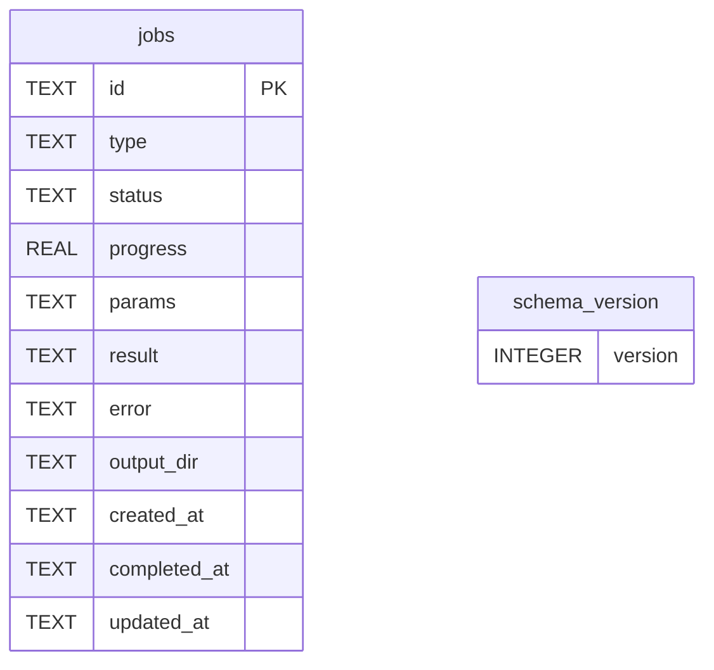

# Vision Studio — Database Schema

> Companion docs: [`ARCHITECTURE.md`](./ARCHITECTURE.md), [`API_ENDPOINTS.md`](./API_ENDPOINTS.md)
> Source of truth: `backend/db/migrations/*.py`, `backend/db/schema_version.py`, `backend/utils/job_store.py`

This document covers the **server-side SQLite database** used by the Python backend, plus the small JSON state files the backend persists next to it (§8). Other Vision Studio state lives elsewhere (see [`ARCHITECTURE.md` §7](./ARCHITECTURE.md#7-persistence)) — `electron-store` and Zustand `localStorage` persist are NOT described here.

---

## 1. Overview

| Attribute | Value |
|-----------|-------|
| Engine | **SQLite 3** (via Python stdlib `sqlite3`), WAL journal mode (the job writer enables it, so `vision_studio.db-wal` / `-shm` sit next to the file while the backend runs) |
| File | `<DATABASE_PATH>` (default `<userData>/data/vision_studio.db`; configurable via the `DATABASE_PATH` env var) |
| Schema version | **2** (constant `SCHEMA_VERSION` in `backend/db/schema_version.py`) |
| Migration model | Forward-only, version-numbered Python modules (`migrate_up` + `migrate_down`) executed in order by `db.migrate.run_migrations` |
| When run | At backend startup — `backend/main.py` calls `run_migrations(DATABASE_PATH)` before instantiating any service |
| Failure mode | The **first** failing migration (an exception, or a module without `migrate_up`) is logged with its traceback and stops the run: `run_migrations` raises `db.migrate.MigrationError(version, filename)` and no later migration runs. The database stays at the last successful version. `main.py` catches it and starts without job persistence (job history stays in memory for that run) |
| Live consumer | The `jobs` table — every generation, edit, timeline-export and ComfyUI-graph job (§3.1) |

---

## 2. Entity-relationship diagram



There are no foreign keys — the two tables are independent. A job's output files live on disk under `OUTPUT_DIR/<job_id>/` (the `output_dir` column records where).

---

## 3. Tables

### 3.1 `jobs`

Durable job history. `JobManager` (`backend/utils/job_manager.py`) stays the in-memory source of truth for live jobs; every change (`add_job`, `update_job`, `update_unless_cancelled`, `cancel`) also hands a snapshot to `JobStore` (`backend/utils/job_store.py`):

- **Never on the event loop.** `JobStore.save()` only enqueues the snapshot; one daemon writer thread drains the queue, coalesces repeated snapshots of the same job (per-step progress) into one upsert per batch, and writes the batch in a single transaction. A write failure is logged and never fails the job.
- **Startup reload.** At startup the store deletes finished rows (`completed` / `failed` / `cancelled`) older than `JOB_RETENTION_HOURS` (24) and loads the last 24 hours, newest first, so `GET /api/jobs` and `GET /api/jobs/{id}` answer across a restart. A row that was `pending` or `processing` when the backend stopped is loaded as `failed` with `error = "The backend stopped before this job finished."`.
- **Shutdown.** The lifespan shutdown drains the writer (`JobManager.close()`).

| Column | Type | Constraints | Description |
|--------|------|-------------|-------------|
| `id` | TEXT | PRIMARY KEY | The API job id (a UUID) |
| `type` | TEXT | NOT NULL | `'image' \| 'video' \| 'edit'` (timeline export and video jobs use `'video'`) |
| `status` | TEXT | NOT NULL | `'pending' \| 'processing' \| 'completed' \| 'failed' \| 'cancelled'` (`JobStatus` in `backend/utils/job_manager.py`) |
| `progress` | REAL | NOT NULL DEFAULT `0.0` | Percentage 0.0–100.0 |
| `params` | TEXT | NOT NULL DEFAULT `'{}'` | JSON of the job's request parameters. **Contains prompts** — stored locally only, never transmitted |
| `result` | TEXT | NULL | JSON result (`images` / `video` URLs, seed, …) once completed |
| `error` | TEXT | NULL | User-facing error message when `status == 'failed'` |
| `output_dir` | TEXT | NOT NULL DEFAULT `''` | Folder the job writes into |
| `created_at` | TEXT | NOT NULL | ISO 8601 UTC with offset (`2026-11-11T20:15:03.120000+00:00`) |
| `completed_at` | TEXT | NULL | ISO 8601 UTC with offset, set on a terminal status |
| `updated_at` | TEXT | NOT NULL | ISO 8601 UTC with offset of the last write |

All timestamps are timezone-aware UTC (`utils/timeutil.utc_now()`); a naive datetime handed to `JobManager` is treated as local time and converted.

**Indexes**

| Name | Columns | Purpose |
|------|---------|---------|
| `idx_jobs_status` | `(status)` | Filter active vs. terminal jobs without a full scan |
| `idx_jobs_created_at` | `(created_at)` | Retention purge and newest-first reload |

**Status state machine** — see [`ARCHITECTURE.md` §5.5](./ARCHITECTURE.md#55-job-lifecycle).

### 3.2 `schema_version`

Tracks the current schema version so the migration runner can compute pending migrations.

| Column | Type | Constraints | Description |
|--------|------|-------------|-------------|
| `version` | INTEGER | NOT NULL | Monotonically increasing integer (starts at 0 for an unmigrated database) |

The table holds **exactly one row** at any time. `set_schema_version` issues `DELETE FROM schema_version` followed by an `INSERT`.

`SCHEMA_VERSION` (in `backend/db/schema_version.py`) is the source-of-truth integer for the latest migration; bump it when adding a new migration file.

### 3.3 Removed tables: `images`, `settings`

Migration 001 created `images` and `settings` (and `idx_images_created_at`) as a forward-looking contract, but nothing in the backend, the Electron main process or the renderer ever read or wrote them. Migration 002 drops them rather than leaving misleading schema. Backend configuration comes from environment variables (`backend/.env.example` lists every one the backend reads); user-facing settings are owned by Electron's `electron-store`.

---

## 4. Migrations

### 4.1 Runner

`backend/db/migrate.py` is the migration runner. Algorithm:

1. Read the current schema version with `get_schema_version(db_path)` — returns `0` if the database doesn't exist or the `schema_version` table is missing.
2. Enumerate `db/migrations/*.py`, sorted by filename. Each filename starts with a zero-padded version (`001_…`, `002_…`).
3. Filter to migrations whose version is strictly greater than the current version.
4. For each pending migration, in order:
   a. `import_module('db.migrations.<filename_without_py>')` (the frozen bundle collects these modules explicitly — `collect_submodules('db.migrations')` in `backend/main.spec` — because they are imported by name).
   b. Call `migration_module.migrate_up(conn)`. A module without `migrate_up` is a failure, not a skip.
   c. On success, `set_schema_version(db_path, version)`.
   d. On any failure, log it (`logging`, with traceback) and raise `MigrationError(version, filename)`. **No later migration runs**: later migrations may depend on the failed one, and applying them on top of a half-migrated schema could corrupt data.
5. Return the resulting schema version.

Migration 002 runs inside an explicit transaction and rolls back on failure, so a failed 002 leaves the version-1 schema intact.

### 4.2 Migration history

| Version | File | Tables added | Indexes added | Tables dropped |
|---------|------|--------------|---------------|----------------|
| 1 | `001_initial_schema.py` | `images`, `jobs` (integer id), `settings`, `schema_version` | `idx_images_created_at`, `idx_jobs_status` | — |
| 2 | `002_persist_jobs.py` | `jobs` rebuilt (TEXT id + `params`, `result`, `output_dir`, `updated_at`) | `idx_jobs_status` (recreated), `idx_jobs_created_at` | `images`, `settings`, `idx_images_created_at` |

#### Migration 001 — Initial schema

**Up** (verbatim from `backend/db/migrations/001_initial_schema.py`):

```sql
CREATE TABLE IF NOT EXISTS images (
    id INTEGER PRIMARY KEY AUTOINCREMENT,
    prompt TEXT NOT NULL,
    negative_prompt TEXT DEFAULT '',
    model TEXT NOT NULL,
    width INTEGER NOT NULL,
    height INTEGER NOT NULL,
    seed INTEGER NOT NULL,
    created_at TEXT NOT NULL DEFAULT (datetime('now')),
    data TEXT
);

CREATE TABLE IF NOT EXISTS jobs (
    id INTEGER PRIMARY KEY AUTOINCREMENT,
    type TEXT NOT NULL,
    status TEXT NOT NULL,
    progress REAL NOT NULL DEFAULT 0.0,
    created_at TEXT NOT NULL DEFAULT (datetime('now')),
    completed_at TEXT,
    error TEXT
);

CREATE TABLE IF NOT EXISTS settings (
    key TEXT PRIMARY KEY,
    value TEXT NOT NULL,
    updated_at TEXT NOT NULL DEFAULT (datetime('now'))
);

CREATE TABLE IF NOT EXISTS schema_version (
    version INTEGER NOT NULL
);

CREATE INDEX IF NOT EXISTS idx_images_created_at ON images(created_at);
CREATE INDEX IF NOT EXISTS idx_jobs_status ON jobs(status);
```

#### Migration 002 — Durable job history

**Up** (from `backend/db/migrations/002_persist_jobs.py`, one transaction):

```sql
ALTER TABLE jobs RENAME TO jobs_v1;          -- when a 001 jobs table exists
CREATE TABLE jobs (
    id TEXT PRIMARY KEY,
    type TEXT NOT NULL,
    status TEXT NOT NULL,
    progress REAL NOT NULL DEFAULT 0.0,
    params TEXT NOT NULL DEFAULT '{}',
    result TEXT,
    error TEXT,
    output_dir TEXT NOT NULL DEFAULT '',
    created_at TEXT NOT NULL,
    completed_at TEXT,
    updated_at TEXT NOT NULL
);
INSERT INTO jobs (id, type, status, progress, error, created_at, completed_at, updated_at)
SELECT CAST(id AS TEXT), type, status, progress, error, created_at,
       completed_at, COALESCE(completed_at, created_at)
FROM jobs_v1;                                -- any 001 rows are kept, ids cast to TEXT
DROP TABLE jobs_v1;
DROP INDEX IF EXISTS idx_jobs_status;
CREATE INDEX idx_jobs_status ON jobs(status);
CREATE INDEX idx_jobs_created_at ON jobs(created_at);
DROP INDEX IF EXISTS idx_images_created_at;
DROP TABLE IF EXISTS images;
DROP TABLE IF EXISTS settings;
```

**Down** restores the 001 shape (job rows are not preserved: their ids are not integers).

`migrate_down` is provided for tooling/test use. The runner does **not** call it; rollback is not a supported operational step in production.

---

## 5. Adding a new migration

1. Pick the next version number — `SCHEMA_VERSION + 1`. Filenames are zero-padded to 3 digits: `003_<short_description>.py`.
2. Implement `migrate_up(conn: sqlite3.Connection) -> None` and `migrate_down(conn: sqlite3.Connection) -> None`. Run `migrate_up` inside a transaction (`BEGIN` … `commit()`, `rollback()` + re-raise on error) so a failure leaves the previous schema intact.
3. Bump `SCHEMA_VERSION` in `backend/db/schema_version.py` to the new number.
4. Add a section to **§4.2 Migration history** above.
5. Cover the change with a test in `backend/tests/` (see `test_migrations.py`) using a temporary file path:

   ```python
   import os, tempfile, sqlite3
   from db.migrate import run_migrations
   from db.schema_version import get_schema_version, SCHEMA_VERSION

   def test_my_migration():
       with tempfile.TemporaryDirectory() as tmp:
           db = os.path.join(tmp, "test.db")
           run_migrations(db)
           assert get_schema_version(db) == SCHEMA_VERSION
           with sqlite3.connect(db) as conn:
               # assert your new table / column / index exists
               ...
   ```

6. If the migration changes the `jobs` table, update `utils/job_store.py` (`_UPSERT_SQL`, `load_recent`) in the same PR.
7. The frozen bundle picks the new module up through `collect_submodules('db.migrations')`, and `--self-check` imports every migration module — no spec edit is needed.

### Anti-patterns to avoid

- **Editing an existing migration after release.** Once a migration ships, it is frozen — old installs have already executed it. Add a new migration to amend the schema instead.
- **Destructive changes without a backup.** Use the rebuild-table pattern (`CREATE new`, `INSERT … SELECT`, `DROP old`, `ALTER RENAME`) — migration 002 is the template.
- **Long-running migrations.** Migrations run synchronously at backend startup *before* the FastAPI app yields readiness. Anything taking more than a few seconds will trip the Main process's readiness probe.
- **Bumping `SCHEMA_VERSION` without adding a migration file** (or vice-versa). The runner trusts that the integer matches the highest-numbered file present.

---

## 6. Operational reference

| Task | How |
|------|-----|
| Find your live database | Default: `<userData>/data/vision_studio.db`. On Windows: `%APPDATA%\vision-studio\data\vision_studio.db`. Override with `DATABASE_PATH` env var. |
| Inspect the schema | `sqlite3 <path> ".schema"` |
| Check current version | `sqlite3 <path> "SELECT version FROM schema_version;"` |
| Recent jobs | `sqlite3 <path> "SELECT id, type, status, created_at FROM jobs ORDER BY created_at DESC LIMIT 20;"` |
| Force-rerun all migrations | Stop the backend, delete the database file (and its `-wal` / `-shm` files), restart the backend (auto-migrates from scratch; job history is lost). |
| Test migrations in isolation | Use `tempfile.TemporaryDirectory` + `run_migrations(db_path)` (see test pattern in §5). The backend test suite points `DATABASE_PATH` at a scratch file (`tests/conftest.py`). |
| Verify migrations idempotency | Run the backend twice in a row; the second start should be a no-op (`get_pending_migrations` returns `[]`). |

---

## 7. Backups & recovery

Vision Studio does **not** ship an automated backup mechanism for the SQLite database. It holds only the last 24 hours of job history (outputs themselves are files under `OUTPUT_DIR`), so losing it loses no media. Manual options:

| Method | When to use |
|--------|-------------|
| File copy while backend is stopped (include `-wal` / `-shm` if present) | Simple, safe |
| `sqlite3 <path> ".backup '<dest>'"` | Live backend; uses the SQLite online backup API (consistent snapshot) |
| `vacuum into '<dest>'` (SQLite ≥ 3.27) | Compact + snapshot in one call |

---

## 8. Persisted JSON state (not SQLite)

The backend keeps a few small state files outside the database. All live under directories the Main process passes in (`MODELS_DIR`, `DATABASE_PATH`'s folder), never inside the app bundle.

| File | Owner | Shape | Write discipline |
|------|-------|-------|------------------|
| `<MODELS_DIR>/.foundry/consents.json` | `foundry/security_policy.py` `ConsentStore` | `{ "consents": { "<model_id>": { "pickle": bool, "trust_remote_code": bool } }, "audit": [{ "model_id", "kind", "action", "at" (UTC ISO 8601) }] }` | Temp file + `os.replace`. A corrupt file is preserved as `consents.json.corrupt` and every consent resets to deny |
| `<MODELS_DIR>/.foundry/library_roots.json` | `foundry/library_roots.py` `RootsStore` | `[{ "id", "path", "layout_hint", "added_at" }]` | Lock-guarded; written on add/remove |
| `<MODELS_DIR>/.foundry/index_state.json` | `foundry/index_service.py` `IndexService` | Version 2: `{ "version": 2, "signatures": {...}, "last_records": {...} }` — per-root change signatures plus each library root's last good records, so a root on an unmounted drive still lists its models as unavailable after a restart (records of roots that no longer exist are dropped). A version-1 file (bare signatures) still loads | Scans serialized by a re-entrant lock; temp file + fsync + `os.replace` (a failed write leaves the previous file intact) |
| `<RETRIEVAL_DATA_DIR>/corpus.json` + `vectors.npz` (default `RETRIEVAL_DATA_DIR` = `<DATABASE_PATH folder>/retrieval`) | `services/retrieval/index_store.py` | `corpus.json` = `{ "version", "generation", "items": [...] }` (a legacy bare-list corpus still loads); `vectors.npz` = `vectors` (the embedding matrix) + the same `generation`, so a vectors file that does not match the corpus is re-embedded instead of mis-ranking | Lock-guarded; vectors then corpus, each written to a temp file, fsynced and swapped in with `os.replace` |

---

_Last verified against the codebase on 2026-11-11. Canonical source: `backend/db/migrations/001_initial_schema.py`, `backend/db/migrations/002_persist_jobs.py`, `backend/db/schema_version.py`, `backend/db/migrate.py`, `backend/utils/job_store.py`._
